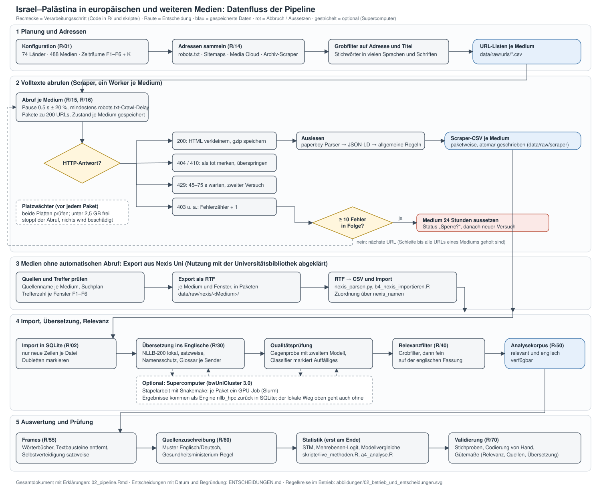

**[Live-Dashboard ansehen](https://vincent-219.github.io/masterarbeit_presentable/)** (Fortschritt und Zwischenergebnisse, alle 30 Minuten aktualisiert)

# Israel–Palästina in europäischen und weiteren Medien

English version: [README_en.md](README_en.md)

Vergleichende Analyse der Berichterstattung über den Israel-Palästina-Konflikt (Gaza und besetztes palästinensisches Gebiet)
seit dem 7. Oktober 2023. Untersucht werden **Framing** (z. B. Genozid, Völkerrecht, Selbstverteidigung, Besatzung) und die
**Nutzung von Quellen** (IDF, Gesundheitsbehörden in Gaza, UN, NGOs, Agenturen), inklusive der Frage, wie oft Angaben als nicht
unabhängig überprüfbar gekennzeichnet werden. Das Repository enthält die gesamte Pipeline: Medienauswahl, Datenerhebung, Übersetzung,
Relevanzfilter, Auswertung und ein Live-Dashboard für den laufenden Betrieb. Es ist Teil einer Masterarbeit.



*Abbildung 1: Datenfluss. Die Abbildung mit den Schleifen und Entscheidungen im laufenden Betrieb steht in
[abbildungen/02_betrieb_und_entscheidungen.svg](abbildungen/02_betrieb_und_entscheidungen.svg).*

## Dashboard (Stand 16.10.2026)

Das Dashboard zeigt Fortschritt, Abdeckung und erste Auswertungen. Es wird mit `skripte/live_dashboard.py` erzeugt und läuft
lokal (`skripte/live_server.py`, Adresse `127.0.0.1:8765`). Ein Schnappschuss ist nicht Teil dieses öffentlichen Repositories,
weil er Texte Dritter enthält (siehe `medien_einordnung/README.md`); er ist auf Anfrage bei den Autorinnen und Autoren erhältlich.

## Stichprobe auf einen Blick

Alle 74 Länder stehen in der Stichprobe auf einer Ebene. Es gibt keine Rangfolge nach Wichtigkeit. Die Länder sind hier nur nach
Region geordnet:

| Region | Länder |
|---|---|
| Europa (37) | DE, UK, IE, FR, IT, ES, EE, LV, LT, PL, RO, NL, BE, CZ, SE, PT, GR, HU, AT, BG, DK, FI, SK, HR, SI, LU, MT, CY, NO, CH, IS, RS, BA, AL, ME, MK, XK |
| Afrika (17) | Algerien, Marokko, Tunesien, Senegal, Elfenbeinküste, Nigeria, Südafrika, Angola, Mosambik, DR Kongo, Ruanda, Äthiopien, Ägypten, Tansania, Kenia, Uganda, Sudan |
| Asien (14) | Indien, Pakistan, China, Indonesien, Bangladesch, Japan, Philippinen, Vietnam, Türkei, Thailand, Myanmar, Südkorea, Irak, Afghanistan |
| Amerika (5) | USA, Mexiko, Kolumbien, Brasilien, Argentinien |
| Osteuropa (1) | Russland |

Je Land sind es in der Regel sechs nationale Medien (in einigen Ländern drei bis fünf), in einigen Ländern kommen Regional- und
Minderheitenmedien hinzu. Alle Analysen, auch die Quellenanalyse, laufen für alle Länder.

Insgesamt 74 Länder und 488 Medien (national, regional/Minderheiten, Übersee). Der Libanon und der Iran sind als selbst beteiligte Konfliktparteien
bewusst nicht im Sample. Die Auswahl der Medien ist je Land so angelegt, dass mindestens ein öffentlich-rechtliches Medium dabei ist
und die übrigen über das politische Spektrum verteilt sind (Tabelle `medien` in `R/01_konfiguration.R`). Die politische Einordnung ist
bei den Ergänzungen noch `unklar`, bis Belege vorliegen (`medien_einordnung/`). Neu ist die Trägerkategorie `staatlich` für
Regierungsmedien ohne öffentlich-rechtliche Unabhängigkeit.

**Zeiträume:** sechs Ereigniszeiträume (F1–F6) zwischen Oktober 2023 und Oktober 2025 plus eine Kontrollstichprobe aus vier
konstruierten Wochen (K). Beschreibung und Begründung in `02_pipeline.Rmd`, Abschnitt „Zeiträume und Kontrollstichprobe“.

## Datenzugänge

| Quelle | Zweck | Stand |
|---|---|---|
| Sitemaps und Archive der Medien | Artikeladressen und Volltexte | `robots.txt` und `Crawl-delay` werden eingehalten |
| Media Cloud (`search.mediacloud.org`) | zusätzliche Artikeladressen je Quelle | höheres API-Kontingent angefragt |
| Nexis Uni | Volltexte für Medien mit Bezahlschranke oder ohne automatisch abrufbares Archiv | Nutzung mit der Universitätsbibliothek abgeklärt und bestätigt (nichtkommerziell, wissenschaftlich) |
| wiso | Volltexte (manueller Export, nur für Medien, die dort geführt werden) | Suchplan in `wiso/` |

## Dateien

| Datei / Ordner | Inhalt |
|---|---|
| `ENTSCHEIDUNGEN.md` | **Protokoll der methodischen Entscheidungen** (Stichprobe, Erhebung, Übersetzung, Messung, Betrieb) mit Datum und Begründung |
| `02_pipeline.Rmd` | **Gesamtdokument**: erklärt jeden Schritt und zeigt den Code aus `R/` und `skripte/` (per `knitr::read_chunk()`) |
| `R/` | Bausteine (Funktionen, Einstellungen), je Baustein ein Skript; `source("R/laden.R")` lädt alle |
| `skripte/` | Aktionen, die man von Hand startet oder die als Dienste laufen: Import, Scraper, Übersetzung, Analysen, Validierung, Dashboard |
| `abbildungen/` | Datenfluss und Betrieb als Grafik (SVG und PNG) |
| `01_pilot_tagesschau.Rmd` | Pilot: tagesschau.de über das Monatsarchiv, ein Monat |
| `04_umfragen.Rmd` | Vergleich mit repräsentativen Umfragen (`umfragen/`) |
| `*_en.Rmd`, `README_en.md` | englische Fassungen (gleicher Code, Text auf Englisch) |
| `laender/` | Länder-Metadaten (Kontinent, UN-Region, Status im Sample), Kandidatenliste und Ersatzmedien |
| `medien_einordnung/` | Belege für die politische Einordnung der Medien (eurotopics, EMSS 2010, Literatur) |
| `nexis/`, `wiso/` | Suchpläne, Quellenlisten und Trefferzahlen für die Datenbanken; Ablauf in `nexis/README.md` |
| `systemd/` | Dienste und Timer für den laufenden Betrieb |
| `run_nightly.R` | Import- und Übersetzungsschleife (Dauerdienst oder Nachtlauf) |

### Bausteine in `R/`

| Skript | Baustein |
|---|---|
| `00_setup.R` | Pakete, Ordner, Parallelrechnen |
| `01_konfiguration.R` | Länder, Sprachen, Medien, Zeiträume (F1–F6, K), Glossar je Sender, Parameter |
| `02_datenbank.R` | SQLite-Schema, Import, Nexis-Zuordnung |
| `03_vorverarbeitung.R` | Bereinigung, Lead/halbe Seite, Grobfilter, Dubletten |
| `10_scraper_allgemein.R` | Volltexte holen, mehrere Medien parallel |
| `11_scraper_tagesschau.R` | tagesschau.de: Monatsarchiv, Volltexte |
| `12_scraper_guardian.R` | The Guardian: Tagesarchive |
| `13_scraper_err.R` | ERR: Such-Schnittstelle und Tageslisten |
| `14_url_sammler.R` | Artikeladressen für alle Medien: robots.txt, Sitemaps, Media Cloud, Archiv-Scraper; Grobfilter auf der Adresse |
| `15_volltext.R` | Volltexte holen (Zwischenspeicher, Pausen) und auslesen: paperboy, JSON-LD, allgemeine Regeln |
| `16_alle_medien.R` | ein Medium komplett, alle Medien parallel, Übersicht über den Stand, Platzwächter |
| `30_nllb.R` | NLLB-200 (1.3B distilled) lokal auf der Grafikkarte: satzweise, Namensschutz, Glossar |
| `32_nachtlauf.R` | Import neuer Scraper-Ergebnisse und Übersetzung in Paketen |
| `40_relevanz.R` | Relevanzfilter auf Englisch |
| `50_korpus.R` | Analysekorpus aus der Datenbank |
| `55_frames.R` | Textbausteine je Medium entfernen, Selbstverteidigung satzweise im israelischen Kontext |
| `60_quellen.R` | Quellenzuschreibung: Muster Englisch und Deutsch, Gesundheitsministerium-Regel |
| `70_validierung.R` | Gütemaße |

## Einrichtung

1. Repository klonen und den Ordner als RStudio-Projekt öffnen.
2. In `02_pipeline.Rmd` den Block **„Pakete“** ausführen (installiert fehlende R-Pakete).
3. Datei `.Renviron` im Projektordner anlegen (wird nicht hochgeladen):
   ```
   MEDIACLOUD_API_KEY=dein-schluessel        # optional, Konto auf search.mediacloud.org
   SCRAPER_KONTAKT="Masterarbeit Medienanalyse, Kontakt: name@universitaet.example"   # steht im User-Agent
   ```
4. Python-Umgebung für die Übersetzung (`~/.virtualenvs/masterarbeit`): `skripte/a2_nllb_einrichten.R` richtet sie unter Windows ein
   (Python 3.12 über uv, Standard: PyTorch mit ROCm für eine AMD-Grafikkarte; für NVIDIA vorher `Sys.setenv(MASTERARBEIT_GPU = "nvidia")`).
   Unter Linux: `skripte/a2_nllb_einrichten.sh amd|nvidia|cpu`. Beide Varianten sind geprüft: AMD (ROCm) auf dem Entwicklungsrechner, NVIDIA
   (CUDA-Pakete von pytorch.org) auf den GPUs des bwUniCluster (A100/H100); der restliche Code ist für beide gleich (PyTorch nennt auch AMD-Karten "cuda").
5. Dienste einrichten (Dateien in `systemd/`; Pfade und Benutzer vorher anpassen):
   ```
   # Benutzerdienste: Scraper, Regler, Übersetzer, Dashboard, Live-Server, Endkontrolle
   cp systemd/masterarbeit-{scraper,scraper-regler,uebersetzer,dashboard,liveserver,endkontrolle}.* ~/.config/systemd/user/
   systemctl --user daemon-reload
   systemctl --user enable --now masterarbeit-scraper-regler.timer masterarbeit-dashboard.timer masterarbeit-liveserver.service
   # optional, systemweit: nächtlicher Übersetzungslauf 1:00–9:00 mit gedrosselter Grafikkarte
   sudo install -m 755 systemd/nachtlauf-gpu /usr/local/bin/
   sudo install -m 644 systemd/masterarbeit-nachtlauf.{service,timer} /etc/systemd/system/
   sudo systemctl daemon-reload && sudo systemctl enable --now masterarbeit-nachtlauf.timer
   ```

## Arbeitsablauf

1. **Erheben:** `Rscript skripte/b2_alle_scrapen.R` sammelt für alle Medien Adressen und Volltexte
   (Übersicht in `data/processed/uebersicht_scraping.csv`). Varianten: `nur-urls`, `nur-volltexte N` (N Worker; im Dauerbetrieb
   wählt `skripte/scraper_start.sh` die Zahl), `aufstockung-…` für die ergänzten Quellen. Nexis-Exporte: `nexis/README.md`.
   Jeder Worker hält die `Crawl-delay`-Angabe seines Mediums ein; die Grundpause beträgt 0,5 s mit Zufallsanteil, bei HTTP 429
   wartet er 45–75 s. Nach 10 Fehlern in Folge wird das Medium für 24 Stunden ausgesetzt. Ein Platzwächter hält den Abruf an,
   wenn auf einer Platte weniger als 2,5 GB frei sind. Seiten ohne verwertbaren Artikel merkt sich der Scraper je Medium.
2. **Workerzahl regeln:** `skripte/scraper_workers.sh` wählt 2 bis 8 Worker nach freiem Arbeitsspeicher, Auslagerungsspeicher und
   Speicherdruck; `skripte/scraper_regler.sh` prüft das alle 3 Minuten (Abbildung 2).
3. **Laufend importieren und übersetzen:** `run_nightly.R` (Dienst `masterarbeit-uebersetzer`) importiert neue Artikel aus den
   Scraper-CSVs und übersetzt in Paketen von höchstens 8 Minuten; Titel und Lead zuerst, danach die Relevanzprüfung. Es läuft immer nur
   eine Übersetzungs-Instanz. Für Ergänzungen bei laufendem Lauf: `skripte/b3_import_aufstockung.R`.
4. **Übersetzungsqualität prüfen:** `skripte/crosscheck_hymt2.py` vergleicht NLLB mit einem zweiten lokalen Modell
   (Hy-MT2-1.8B); `skripte/qualitaet_titel.py` und `skripte/qualitaet_halbseite.py` trainieren daraus einen Classifier, der
   auffällige Übersetzungen markiert.
5. **Analysieren:** Korpus laden, Wörterbücher, Frames, Quellenzuschreibung, STM und Mehrebenenmodelle
   (`skripte/a4_analyse.R`, `skripte/live_methoden.R`). Die statistischen Methoden laufen erst am Schluss.
6. **Validieren:** Relevanz, Frames und Quellen an Stichproben (`skripte/a5_validierung.R`, `R/70_validierung.R`).
7. **Beobachten:** Das Dashboard `data/live/dashboard.html` wird alle 5 Minuten gebaut; `skripte/live_server.py` liefert es unter
   `http://127.0.0.1:8765/dashboard.html` samt Echtzeit-Stand. `skripte/endkontrolle.py` rechnet nach Abschluss alles einmal
   exakt neu und schreibt die Prüfliste `data/live/endkontrolle.md`.

## Daten und Recht

- Das Volltextkorpus wird **nicht** veröffentlicht und liegt nie im Repository (§ 60d UrhG, Nutzungsbedingungen der Medien und
  Datenbanken). Teilbar sind höchstens IDs, URLs und abgeleitete Kennzahlen.
- Paywalls werden nicht umgangen. Medien mit Bezahlschranke kommen über die Bibliothek (Nexis Uni, wiso).
- Die Scraper halten sich an die `robots.txt` (gesperrte Seiten und Pfade werden ausgelassen, `Crawl-delay` wird übernommen),
  identifizieren sich per User-Agent mit Kontaktadresse und halten Pausen ein.
- Nexis und wiso: Nutzung mit der Universitätsbibliothek abgeklärt; der Export folgt den Lizenzbedingungen (`nexis/README.md`).
- Die tagesschau-API erlaubt höchstens 60 Abrufe pro Stunde.
- Die Übersetzung läuft ausschließlich lokal; es gehen keine Artikeltexte an Cloud-Dienste.

## Stand

- [x] Untersuchungsdesign (Länder, Medien, Zeiträume)
- [x] Scraper-, Import- und Übersetzungs-Pipeline mit realen Daten ausgeführt
- [x] Nexis-Export für die Medien, die der Scraper nicht bekommt
- [x] Erweiterung auf Norwegen, Schweiz, Island und 23 weitere Länder (Medien, Sprachen, Suchbegriffe konfiguriert)
- [x] Auswahl der Medien begründen, politische Einordnung belegen (`medien_einordnung/`; offen: Paraméter, Kıbrıs Postası)
- [x] Zeiträume gegen eine Chronologie prüfen, Einwohnerzahlen mit Eurostat abgleichen (`ENTSCHEIDUNGEN.md`)
- [ ] Volltextabruf, Import und Übersetzung für die 23 weiteren Länder abschließen; danach Gesamtübersicht aktualisieren
- [ ] Belege für die politische Einordnung der ergänzten Medien
- [ ] Literaturrecherche und Exposé

## Offene methodische Punkte

- Wörterbuch-Frames (Selbstverteidigung nach den Satzregeln) an Originalsätzen codieren (`skripte/a5_validierung.R`, Abschnitt `val-frames`).
- Wortstämme des Grobfilters von Muttersprachler:innen gegenlesen lassen, besonders für die neuen Sprachen (Arabisch, Hindi, Urdu, Serbisch/Bosnisch, Albanisch).
- Englische Wörterbücher und Zuschreibungsmuster an Originalsätzen validieren.
- Anzahl der Themen (K) im STM nach `searchK()` und Lektüre festlegen und begründen.
- Übersetzungsqualität für Sprachen ohne Vergleichsmodell (Ersatz: Rückübersetzung) klären.

## Workflow (Snakemake)

Übersetzung und Bewertung auf dem bwUniCluster laufen als Snakemake-Workflow mit Abhängigkeitsgraph, fortsetzbar und per Slurm parallel. Aufbau, Graph und Bedienung: [workflow/README.md](workflow/README.md); Zugang zum Cluster: [docs/HPC.md](docs/HPC.md).


*Gesamtablauf der Pipeline (Blau: eigener PC, Gelb: auch auf dem Cluster).*


*Letzter Lauf des Workflows, mit Zustand, Protokoll und Zeitbalken.*

Quelltext zu jedem Schritt: [workflow/README.md, Abschnitt "Schaubild mit Code"](workflow/README.md#schaubild-mit-code).
