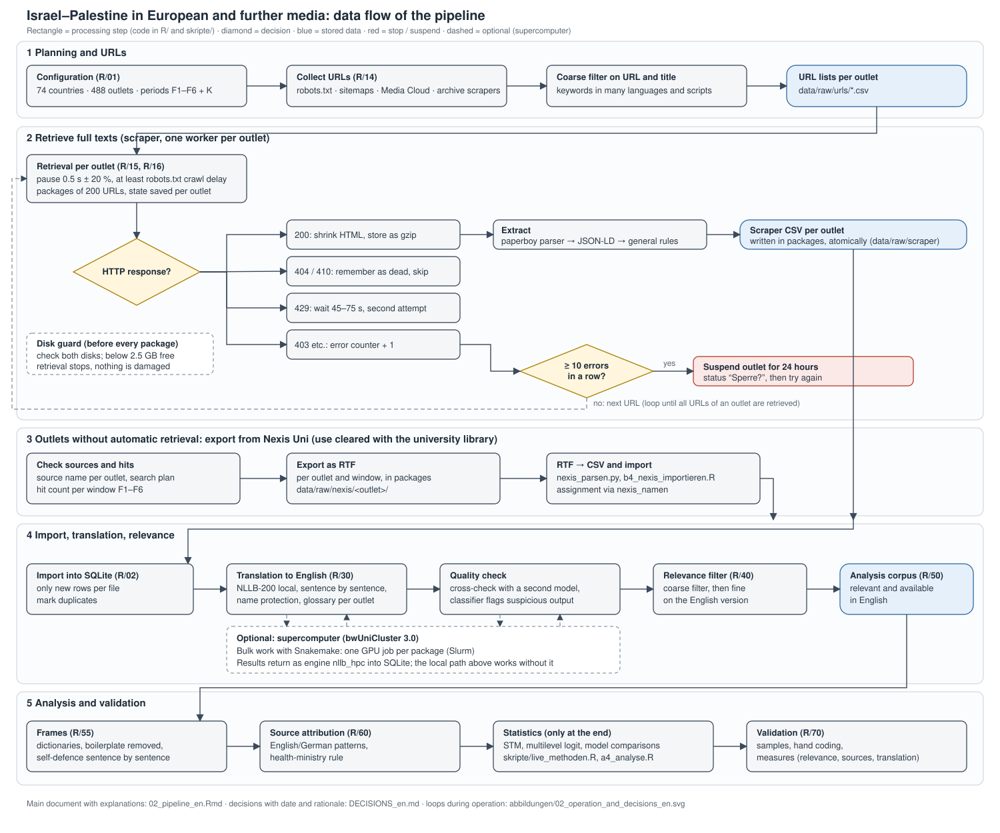
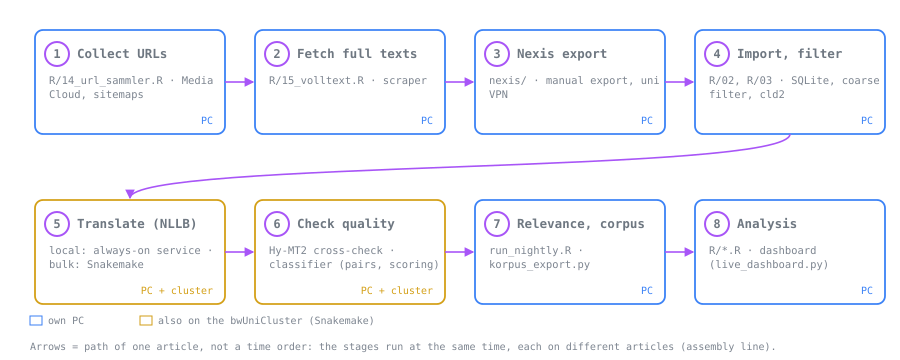
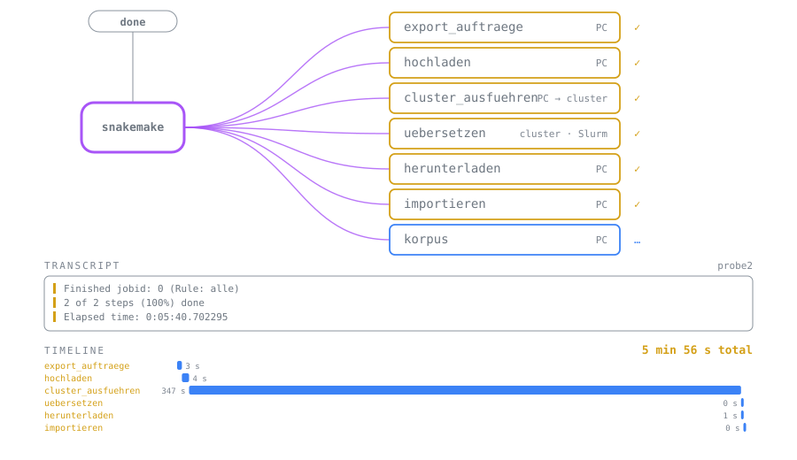
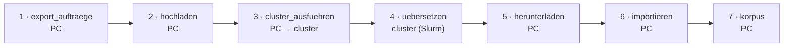

Deutsche Fassung: [README.md](README.md)

# Israel–Palestine in European and Further Media

A comparative analysis of coverage of the Israel–Palestine conflict (Gaza and the occupied Palestinian territory) since
7 October 2023. The project studies **framing** (e.g. genocide, international law, self-defence, occupation) and the **use of
sources** (IDF, health authorities in Gaza, UN, NGOs, agencies), including how often claims are marked as not independently
verifiable. The repository contains the whole pipeline: media selection, data collection, translation, relevance filtering,
analysis and a live dashboard for day-to-day operation. It is part of a master's thesis.



*Figure 1: Data flow. Loops and decisions during operation are shown in
[abbildungen/02_operation_and_decisions_en.svg](abbildungen/02_operation_and_decisions_en.svg).*

## Dashboard (as of 16 Oct 2026)

The dashboard shows progress, coverage and first results. It is generated by `skripte/live_dashboard.py` and runs locally
(`skripte/live_server.py`, address `127.0.0.1:8765`). A snapshot is not part of this public repository because it contains
third-party text (see `medien_einordnung/README_en.md`); it is available on request from the authors.

## Sample at a glance

All 74 countries are on the same level in the sample. There is no ranking by importance. They are only grouped by region here:

| Region | Countries |
|---|---|
| Europe (37) | DE, UK, IE, FR, IT, ES, EE, LV, LT, PL, RO, NL, BE, CZ, SE, PT, GR, HU, AT, BG, DK, FI, SK, HR, SI, LU, MT, CY, NO, CH, IS, RS, BA, AL, ME, MK, XK |
| Africa (17) | Algeria, Morocco, Tunisia, Senegal, Côte d'Ivoire, Nigeria, South Africa, Angola, Mozambique, DR Congo, Rwanda, Ethiopia, Egypt, Tanzania, Kenya, Uganda, Sudan |
| Asia (14) | India, Pakistan, China, Indonesia, Bangladesh, Japan, Philippines, Vietnam, Türkiye, Thailand, Myanmar, South Korea, Iraq, Afghanistan |
| Americas (5) | USA, Mexico, Colombia, Brazil, Argentina |
| Eastern Europe (1) | Russia |

As a rule there are six national outlets per country (three to five in some), and some countries add regional and minority outlets.
All analyses, including the source analysis, cover all countries.

In total 74 countries and 488 outlets (national, regional/minority, overseas). Lebanon and Iran are deliberately not in the sample because they
are themselves parties to the conflict. Per country, at least one public-service outlet is included and the others are spread across the
political spectrum (table `medien` in `R/01_konfiguration.R`). The political classification of the additions is `unklar` (unclear) until
evidence is added (`medien_einordnung/`). A new ownership category `staatlich` marks government outlets without public-service
independence.

**Periods:** six event periods (F1–F6) between October 2023 and October 2025 plus a control sample of four constructed weeks (K).
Description and rationale in `02_pipeline_en.Rmd`, section “Periods and Control Sample”.

## Data access

| Source | Purpose | Status |
|---|---|---|
| Sitemaps and archives of the outlets | article URLs and full texts | `robots.txt` and `Crawl-delay` are respected |
| Media Cloud (`search.mediacloud.org`) | additional article URLs per source | higher API quota requested |
| Nexis Uni | full texts for outlets behind a paywall or without a retrievable archive | use confirmed as permitted by the university library (non-commercial, scientific) |
| wiso | full texts (manual export, only for outlets listed there) | search plan in `wiso/` |

## Files

| File / folder | Content |
|---|---|
| `DECISIONS_en.md` (German original: `ENTSCHEIDUNGEN.md`) | **Log of methodological decisions** (sample, collection, translation, measurement, operation) with date and rationale |
| `02_pipeline.Rmd`, `02_pipeline_en.Rmd` | **Main document**: explains every step and shows the code from `R/` and `skripte/` (via `knitr::read_chunk()`) |
| `R/` | building blocks (functions, settings), one script each; `source("R/laden.R")` loads all |
| `skripte/` | actions started by hand or run as services: import, scraper, translation, analyses, validation, dashboard |
| `abbildungen/` | data flow and operation diagrams (SVG and PNG) |
| `01_pilot_tagesschau*.Rmd` | pilot: tagesschau.de via the monthly archive, one month |
| `04_umfragen.Rmd` | comparison with representative surveys (`umfragen/`) |
| `laender/` | country metadata (continent, UN region, status in the sample), candidate list and replacement outlets |
| `medien_einordnung/` | evidence for the political classification of the outlets (eurotopics, EMSS 2010, literature) |
| `nexis/`, `wiso/` | search plans, source lists and hit counts for the databases; procedure in `nexis/README.md` |
| `systemd/` | services and timers for operation |
| `run_nightly.R` | import and translation loop (continuous service or night run) |

## Setup

1. Clone the repository and open the folder as an RStudio project.
2. Run the **“Packages”** section (chunk `pakete`) in `02_pipeline_en.Rmd` (installs missing R packages).
3. Create `.Renviron` in the project folder (not uploaded):
   ```
   MEDIACLOUD_API_KEY=your-key        # optional, account on search.mediacloud.org
   SCRAPER_KONTAKT="Master's thesis media analysis, contact: name@university.example"   # goes into the User-Agent
   ```
4. Python environment for translation (`~/.virtualenvs/masterarbeit`): `skripte/a2_nllb_einrichten.R` sets it up on Windows
   (Python 3.12 via uv, PyTorch with ROCm for an AMD GPU). On Linux, install the matching PyTorch packages for your GPU into the
   same environment, then `transformers` and `sentencepiece`.
5. Set up the services (files in `systemd/`; adjust paths and user first):
   ```
   # user services: scraper, regulator, translator, dashboard, live server, final check
   cp systemd/masterarbeit-{scraper,scraper-regler,uebersetzer,dashboard,liveserver,endkontrolle}.* ~/.config/systemd/user/
   systemctl --user daemon-reload
   systemctl --user enable --now masterarbeit-scraper-regler.timer masterarbeit-dashboard.timer masterarbeit-liveserver.service
   # optional, system-wide: night-time translation run 1:00–9:00 with a throttled GPU
   sudo install -m 755 systemd/nachtlauf-gpu /usr/local/bin/
   sudo install -m 644 systemd/masterarbeit-nachtlauf.{service,timer} /etc/systemd/system/
   sudo systemctl daemon-reload && sudo systemctl enable --now masterarbeit-nachtlauf.timer
   ```

## Workflow

1. **Collect:** `Rscript skripte/b2_alle_scrapen.R` gathers URLs and full texts for all outlets (overview in
   `data/processed/uebersicht_scraping.csv`). Variants: `nur-urls`, `nur-volltexte N` (N workers; in continuous operation
   `skripte/scraper_start.sh` chooses the number), `aufstockung-…` for the added sources. Nexis exports: `nexis/README.md`.
   Each worker respects its outlet's `Crawl-delay`; the base pause is 0.5 s with a random component, and on HTTP 429 it waits
   45–75 s. After 10 errors in a row an outlet is suspended for 24 hours. A disk guard stops retrieval when less than 2.5 GB is free
   on either disk. The scraper remembers pages without a usable article per outlet.
2. **Regulate the number of workers:** `skripte/scraper_workers.sh` picks 2 to 8 workers based on free memory, swap and kernel
   memory pressure; `skripte/scraper_regler.sh` checks every 3 minutes (Figure 2).
3. **Import and translate continuously:** `run_nightly.R` (service `masterarbeit-uebersetzer`) imports new articles from the
   scraper CSVs and translates in packages of at most 8 minutes, titles and leads first, then the relevance check. Only one
   translation instance runs at a time.
4. **Check translation quality:** `skripte/crosscheck_hymt2.py` compares NLLB with a second local model (Hy-MT2-1.8B);
   `skripte/qualitaet_titel.py` and `skripte/qualitaet_halbseite.py` train a classifier that flags suspicious translations.
5. **Analyse:** load the corpus, dictionaries, frames, source attribution, STM and multilevel models (`skripte/a4_analyse.R`,
   `skripte/live_methoden.R`). The statistical methods run only at the very end.
6. **Validate:** relevance, frames and sources on samples (`skripte/a5_validierung.R`, `R/70_validierung.R`).
7. **Monitor:** the dashboard `data/live/dashboard.html` is rebuilt every 5 minutes; `skripte/live_server.py` serves it at
   `http://127.0.0.1:8765/dashboard.html` with a real-time status. `skripte/endkontrolle.py` recomputes everything once after
   completion and writes the checklist `data/live/endkontrolle.md`.

## Data and law

- The full-text corpus is **not** published and is never in the repository (§ 60d UrhG, terms of use of the outlets and databases).
  At most IDs, URLs and derived figures can be shared.
- Paywalls are not bypassed. Paywalled outlets come through the library (Nexis Uni, wiso).
- The scrapers follow `robots.txt` (blocked pages and paths are skipped, `Crawl-delay` is adopted), identify themselves in the
  User-Agent with a contact address and keep pauses.
- Nexis and wiso: use cleared with the university library; the export follows the licence terms (`nexis/README.md`).
- The tagesschau API allows at most 60 requests per hour.
- Translation runs locally only; no article text is sent to cloud services.

## Status

- [x] Research design (countries, outlets, periods)
- [x] Scraper, import and translation pipeline run with real data
- [x] Nexis export for the outlets the scraper cannot get
- [x] Extension to Norway, Switzerland, Iceland and 23 further countries (outlets, languages, search terms configured)
- [x] Justify the choice of outlets, document political classification (`medien_einordnung/`; open: Paraméter, Kıbrıs Postası)
- [x] Check periods against a chronology, compare population figures with Eurostat (`ENTSCHEIDUNGEN.md`)
- [ ] Finish retrieval, import and translation for the 23 further countries; then update the overall summary
- [ ] Evidence for the political classification of the added outlets
- [ ] Literature review and proposal

## Open methodological points

- Code dictionary frames and the self-defence sub-frames on original sentences (`skripte/a5_validierung.R`, section `val-frames`).
- Have native speakers proofread the stems of the coarse filter, especially for the new languages (Arabic, Hindi, Urdu, Serbian/Bosnian, Albanian).
- Validate English dictionaries and attribution patterns on original sentences.
- Fix and justify the number of topics (K) in the STM after `searchK()` and reading.
- Clarify translation quality for languages without a comparison model (substitute: back-translation).

## Cluster workflow (Snakemake)

Bulk translation on the bwUniCluster runs as a Snakemake workflow (export, upload, one GPU Slurm job per package, download, import; resumable). Graph and usage: [workflow/README.md](workflow/README.md); the dashboard has a "Workflow (Snakemake)" section. The continuous local translator remains for the incoming trickle of new articles.



*Overall pipeline (blue: own PC, yellow: also on the cluster).*



*Last workflow run, with state, transcript and timeline.*

The individual rules of the Snakemake part (source code: [workflow/README.md](workflow/README.md#schaubild-mit-code), German):



Source code for every step: [workflow/README.md, section "Schaubild mit Code"](workflow/README.md#schaubild-mit-code) (German).
