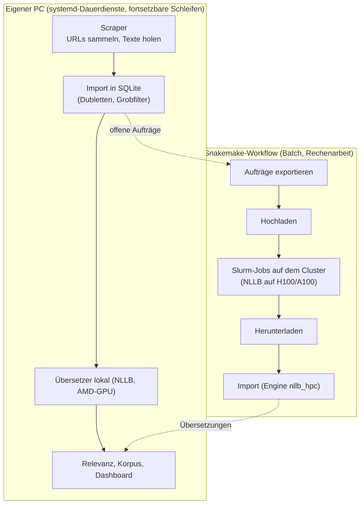
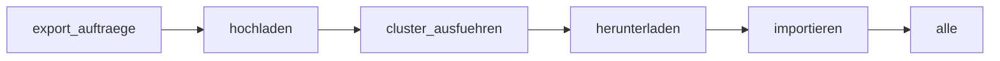
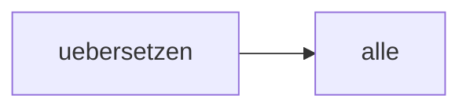
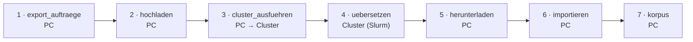

# Workflow (Snakemake)

Übersetzung und Bewertung großer Textmengen laufen als **Snakemake-Workflow**: reproduzierbar, fortsetzbar und mit sichtbarem Abhängigkeitsgraphen.
Der Workflow ergänzt die Dauerdienste (Scraper, Importeur, Übersetzer auf dem eigenen PC), er ersetzt sie nicht.


*Das Schaubild zeigt den letzten Lauf (`python3 workflow/schaubild.py <lauf>` erzeugt es neu; im Dashboard ist es live).*

## Graph statt Schleifen

Das gilt **nur für diesen Batch-Abschnitt** (Übersetzung und Qualitätsbewertung auf dem Cluster). Der Rest der Pipeline (Sammeln, Import, Relevanz, Auswertung) läuft als Dauerdienste und Schleifen und ist bewusst kein Graph.

Früher war dieser Abschnitt eine **Skriptkette mit Schleifen**: ein Shell-Skript, das nacheinander exportiert, hochlädt, wartet, herunterlädt und importiert, mit `for`-Schleifen über Felder und Pakete und einem Fortschrittsstand, der nur im Kopf des Skripts (oder in Zwischendateien) steckte. Bricht so etwas mittendrin ab, muss man wissen, wo man weitermacht.

Jetzt ist jeder Befehl eine **Regel** (ein Knoten) mit dem, was sie braucht (`input`) und dem, was sie erzeugt (`output`). Die Kanten ergeben sich daraus: Wenn die Ausgabe der einen Regel die Eingabe der nächsten ist, hängt die nächste von ihr ab. Snakemake baut daraus den Graphen und führt ihn selbst aus:

- **Reihenfolge:** Sie steht nirgends als Liste. Snakemake leitet sie aus Ein- und Ausgaben ab (`snakemake --rulegraph` zeichnet den Graphen; `workflow/schaubild.py` macht daraus das Bild).
- **Pakete statt Schleifen:** Statt `for paket in …` steht eine Regel mit Platzhaltern (`{feld}`, `{nr}`). Snakemake macht daraus so viele Aufgaben, wie Pakete da sind, und reicht jede als eigenen Slurm-Job ein. Wie viele es sind, steht erst nach dem Export fest (Checkpoint `export_auftraege`).
- **Fortsetzen:** Eine Aufgabe gilt als erledigt, wenn ihre Ausgabedatei (oder Markerdatei) existiert. Ein neuer Aufruf führt nur aus, was fehlt oder veraltet ist, in beliebiger Reihenfolge der Abbrüche.
- **Parallel:** Aufgaben ohne Abhängigkeit untereinander laufen gleichzeitig (`--jobs 4`).
- **Nachvollziehbar:** Zu jeder Aufgabe gibt es ein Protokoll (`data/hpc/<lauf>/logs/`) und eine Markerdatei mit Zeitstempel; daraus zeichnet das Schaubild die Zeitbalken.

Das ist derselbe Gedanke wie bei `make`: das Ziel nennen (`importiert`), nicht die Schritte aufzählen.

## Was wo läuft



Warum der Scraper **nicht** im Graphen steht: Sein Engpass sind Wartezeiten zwischen Anfragen und das Kontingent von Media Cloud, nicht die Abhängigkeiten. Ein Graph würde ihn nicht schneller machen.
Scrapen bleibt bewusst auf dem eigenen PC (Nutzungsvorgaben des Clusters, Kontaktkennung im User-Agent).

## Lokaler Teil (`workflow/Snakefile`)



| Regel | Aufgabe | Eingabe → Ausgabe | Werkzeug |
|---|---|---|---|
| `export_auftraege` (Checkpoint) | offene Übersetzungen aus der Datenbank in Pakete schreiben (nur lesend) | Datenbank → `data/hpc/<lauf>/auftraege/<feld>/auftrag_<feld>_<nnn>.jsonl.gz` | `skripte/hpc/export_offen.py` |
| `hochladen` | Pakete und Cluster-Skripte per rsync kopieren | Pakete → Marker `hochgeladen_<feld>.ok` | `rsync`, `ssh` |
| `cluster_ausfuehren` | auf dem Login-Knoten den Cluster-Workflow starten und auf die Jobs warten | Marker → `berechnet_<feld>.ok` | `ssh`, Snakemake (Slurm) |
| `herunterladen` | Ergebnisdateien holen | Cluster → `data/hpc/<lauf>/ergebnisse/<feld>/` | `rsync` |
| `importieren` | Ergebnisse in `uebersetzung` schreiben (Engine `nllb_hpc`, `INSERT OR IGNORE`) | Ergebnisse → `importiert_<feld>.ok` | `skripte/hpc/import_ergebnis.py` |
| `korpus` | Analysekorpus als eingefrorene Datei exportieren (mit Qualitätsmarken) | Datenbank → `data/korpus_export/korpus_<lauf>.csv.gz` | `skripte/korpus_export.py` |

Felder: `titel`, `lead`, `halbseite` (`workflow/config.yaml`). Der Laufname ist standardmäßig das heutige Datum; ein neuer Name exportiert den aktuellen Stand offener Aufträge neu.

## Cluster-Teil (`workflow/hpc/Snakefile`)

Läuft auf dem Login-Knoten des bwUniCluster 3.0 und reicht **je Paket einen Slurm-Job mit einer GPU** ein (Warteschlange und Laufzeit in `workflow/config.yaml`).



| Regel | Aufgabe | Ressourcen |
|---|---|---|
| `uebersetzen` | ein Paket mit NLLB (`skripte/hpc/nllb_cluster.py`) übersetzen | `gpu_h100`, 1 GPU, 24 Kerne, bis 12 h |

## Schaubild mit Code

<!-- code:start -->

Ablauf von links nach rechts; jede Nummer steht bei der Regel unten mit ihrem echten Quelltext.



### 1 · `export_auftraege` (PC)

Liest nur die Datenbank und schreibt Pakete (Checkpoint: die Zahl der Pakete steht erst danach fest).

Quelle: `workflow/Snakefile`

```python
checkpoint export_auftraege:
    """Offene Übersetzungsaufträge aus der Datenbank in Pakete schreiben (nur lesend). Wie viele Pakete es gibt, steht erst danach fest."""
    output:
        ordner=directory(f"data/hpc/{LAUF}/auftraege/{{feld}}"),
    params:
        chunk=config["chunk"],
        limit=config["limit"],
    log:
        f"data/hpc/{LAUF}/logs/export_{{feld}}.log",
    shell:
        "python3 skripte/hpc/export_offen.py {wildcards.feld} --ordner {output.ordner} --chunk {params.chunk} --limit {params.limit} > {log} 2>&1"
```

### 2 · `hochladen` (PC)

Kopiert Pakete und Cluster-Skripte per rsync.

Quelle: `workflow/Snakefile`

```python
rule hochladen:
    """Pakete und Cluster-Skripte per rsync auf den Cluster kopieren."""
    input:
        ordner=f"data/hpc/{LAUF}/auftraege/{{feld}}",
    output:
        marker=touch(f"data/hpc/{LAUF}/marker/hochgeladen_{{feld}}.ok"),
    params:
        ssh=SSH, host=HOST, remote=REMOTE, lauf=LAUF,
    log:
        f"data/hpc/{LAUF}/logs/hochladen_{{feld}}.log",
    shell:
        """
        {params.ssh} {params.host} 'mkdir -p {params.remote}/auftraege/{params.lauf}/{wildcards.feld} {params.remote}/ergebnisse/{params.lauf}/{wildcards.feld}' > {log} 2>&1
        rsync -a -e "{params.ssh}" workflow/hpc/Snakefile workflow/config.yaml skripte/hpc/nllb_cluster.py skripte/hpc/snakemake_einrichten.sh {params.host}:{params.remote}/ >> {log} 2>&1
        rsync -a --delete -e "{params.ssh}" {input.ordner}/ {params.host}:{params.remote}/auftraege/{params.lauf}/{wildcards.feld}/ >> {log} 2>&1
        """
```

### 3 · `cluster_ausfuehren` (PC → Cluster)

Startet per SSH den Cluster-Workflow und wartet, bis alle Jobs fertig sind.

Quelle: `workflow/Snakefile`

```python
rule cluster_ausfuehren:
    """Auf dem Cluster den Workflow workflow/hpc/Snakefile starten: je Paket ein Slurm-Job mit GPU. Wartet, bis alle Jobs fertig sind."""
    input:
        f"data/hpc/{LAUF}/marker/hochgeladen_{{feld}}.ok",
    output:
        marker=touch(f"data/hpc/{LAUF}/marker/berechnet_{{feld}}.ok"),
    params:
        venv=config["cluster"]["snakemake_venv"], ssh=SSH, host=HOST, remote=REMOTE, lauf=LAUF,
        # Aufruf-Überschreibung, z. B. --config partition=dev_gpu_h100 laufzeit_min=30 (nur für Tests)
        extra="".join(f" {k}={config[k]}" for k in ("partition", "laufzeit_min") if config.get(k)),
    log:
        f"data/hpc/{LAUF}/logs/cluster_{{feld}}.log",
    shell:
        """
        {params.ssh} {params.host} 'cd {params.remote} && source ~/{params.venv}/bin/activate && \
          snakemake -s Snakefile --configfile config.yaml --config lauf={params.lauf}{params.extra} felder="[{wildcards.feld}]" \
          --executor slurm --jobs 4 --latency-wait 60 --rerun-incomplete' > {log} 2>&1
        """
```

### 4 · `uebersetzen` (Cluster (Slurm))

Ein Job pro Paket mit einer GPU; läuft parallel, soweit die Warteschlange es erlaubt.

Quelle: `workflow/hpc/Snakefile`

```python
rule uebersetzen:
    """Ein Paket mit NLLB auf einer GPU übersetzen (Testversion ohne Glossar und Namensschutz; Engine nllb_hpc, siehe docs/HPC.md)."""
    input:
        "auftraege/" + LAUF + "/{feld}/auftrag_{feld}_{nr}.jsonl.gz",
    output:
        "ergebnisse/" + LAUF + "/{feld}/ergebnis_{feld}_{nr}.jsonl.gz",
    resources:
        slurm_partition=config.get("partition") or config["cluster"]["partition"],
        runtime=int(config.get("laufzeit_min") or config["cluster"]["laufzeit_min"]),
        cpus_per_task=config["cluster"]["cpus"],
        gres=f"gpu:{config['cluster']['gpus']}",
    log:
        "logs/" + LAUF + "/uebersetzen_{feld}_{nr}.log",
    params:
        venv=config["cluster"]["venv"],
    shell:
        "source ~/{params.venv}/bin/activate && python nllb_cluster.py {input} {output} --batch 128 > {log} 2>&1"
```

### 5 · `herunterladen` (PC)

Holt die Ergebnisdateien.

Quelle: `workflow/Snakefile`

```python
rule herunterladen:
    """Ergebnisdateien vom Cluster holen."""
    input:
        f"data/hpc/{LAUF}/marker/berechnet_{{feld}}.ok",
    output:
        marker=touch(f"data/hpc/{LAUF}/marker/heruntergeladen_{{feld}}.ok"),
    params:
        ssh=SSH, host=HOST, remote=REMOTE, lauf=LAUF,
        ziel=f"data/hpc/{LAUF}/ergebnisse/{{feld}}",
    log:
        f"data/hpc/{LAUF}/logs/herunterladen_{{feld}}.log",
    shell:
        """
        mkdir -p {params.ziel}
        rsync -a -e "{params.ssh}" {params.host}:{params.remote}/ergebnisse/{params.lauf}/{wildcards.feld}/ {params.ziel}/ > {log} 2>&1
        """
```

### 6 · `importieren` (PC)

Schreibt als Engine nllb_hpc in die Datenbank (INSERT OR IGNORE, also wiederholbar).

Quelle: `workflow/Snakefile`

```python
rule importieren:
    """Ergebnisse in die Tabelle uebersetzung schreiben (Engine nllb_hpc; INSERT OR IGNORE, nichts wird überschrieben)."""
    input:
        f"data/hpc/{LAUF}/marker/heruntergeladen_{{feld}}.ok",
    output:
        marker=touch(f"data/hpc/{LAUF}/marker/importiert_{{feld}}.ok"),
    params:
        ordner=f"data/hpc/{LAUF}/ergebnisse/{{feld}}",
    log:
        f"data/hpc/{LAUF}/logs/import_{{feld}}.log",
    shell:
        """
        for f in {params.ordner}/ergebnis_*.jsonl.gz; do
          [ -e "$f" ] && python3 skripte/hpc/import_ergebnis.py {wildcards.feld} "$f"
        done > {log} 2>&1 || true
        """
```

### 7 · `korpus` (PC)

Friert den Analysekorpus mit Qualitätsmarken als Datei ein.

Quelle: `workflow/Snakefile`

```python
rule korpus:
    """Analysekorpus als eingefrorene Datei exportieren (R/50_korpus.R-Auswahl, mit Qualitätsmarken); getrennt aufrufbar: snakemake -s workflow/Snakefile --cores 1 korpus"""
    output:
        f"data/korpus_export/korpus_{LAUF}.csv.gz",
    log:
        f"data/hpc/{LAUF}/logs/korpus.log",
    shell:
        "python3 skripte/korpus_export.py --aus {output} > {log} 2>&1"
```

<!-- code:ende -->

## Qualitäts-Classifier auf dem Cluster (`workflow/qualitaet/Snakefile`)

Die GPU-lastigen Teile des Classifiers für Halbseiten laufen ebenfalls als Workflow, mit denselben fünf Schritten (Export, Hochladen, Slurm-Job je Paket, Herunterladen, Übernehmen):

| Art | Aufgabe | Ergebnis |
|---|---|---|
| `paare` | Stichprobe je Sprache mit Hy-MT2 erneut übersetzen (Vergleichstexte für das Training) | Zeilen in `data/qualitaet_halbseiten_paare.jsonl` |
| `rueck` | für Sprachen **ohne Hy-MT2**: die englische Fassung mit NLLB zurück in die Originalsprache übersetzen und mit dem Original vergleichen (Ersatzreferenz) | Zeilen mit `b_typ = rueck` in derselben Paardatei |
| `score` | alle noch unbewerteten Halbseiten mit dem trainierten Modell bewerten | `data/qualitaet_halbseite.csv` (zusammengeführt, fortsetzbar) |

Das **Training bleibt lokal** (wenige Minuten, CPU): `python3 skripte/qualitaet_halbseite.py train`.
Reihenfolge: `paare` (und `rueck`) → lokal trainieren → `score`. Die Rückübersetzung ist ein Ersatz mit Einschränkung (gleiches Modell hin und zurück); Begründung und Kalibrierung: `ENTSCHEIDUNGEN.md`. Einmalig auf dem Cluster: `bash ~/masterarbeit/qualitaet_einrichten.sh` (Umgebung `~/venv-qualitaet`; das Skript kommt beim ersten Hochladen mit).

```bash
snakemake -s workflow/qualitaet/Snakefile --cores 1 --config lauf=q1 'arten=[paare]' n=300 sprachen=DE,IT,ES,FR,PT,PL,CS,NL,RU,TR
snakemake -s workflow/qualitaet/Snakefile --cores 1 --config lauf=q2 'arten=[score]'            # nur noch unbewertete; mit alle=1 alle neu bewerten
```

Weitere Sprachen (Hy-MT2 kann 33) kommen über `sprachen=…`; vorher muss `NAMEN` in `skripte/qualitaet_halbseite.py` und `SPRACHEN` in `skripte/qualitaet_titel.py` erweitert werden.
**Stand:** Export und Übernahme lokal geprüft (Trockenlauf, Testexport, Übernahme mit Testdatei, wiederholbar); der Lauf auf dem Cluster ist noch **nicht** getestet (Umgebung, Hy-MT2-Download von Hugging Face).

## Bedienung

Voraussetzungen: Uni-VPN im Cluster-Modus und `ssh uc3` (siehe [docs/HPC.md](../docs/HPC.md)); auf dem Cluster einmalig `skripte/hpc/snakemake_einrichten.sh` (eigene Umgebung `~/venv-snakemake` mit Python ≥ 3.11 für Snakemake und das Slurm-Plug-in; das System-Python des Clusters ist 3.9);
lokal Snakemake (`uv tool install --python 3.12 snakemake`).

```bash
snakemake -s workflow/Snakefile -n                                  # Trockenlauf: zeigt, was getan würde
snakemake -s workflow/Snakefile --cores 1                           # alles für Titel, Lead und Halbseiten
snakemake -s workflow/Snakefile --cores 1 --config 'felder=[titel]' lauf=test   # nur Titel, eigener Laufname
snakemake -s workflow/Snakefile --cores 1 korpus                    # nur den Korpus exportieren
```

Fortsetzen: Jeder Schritt hinterlässt eine Marker-Datei. Bricht etwas ab (VPN weg, Job fehlgeschlagen), startet derselbe Befehl mit demselben Laufnamen dort neu; Logs liegen unter `data/hpc/<lauf>/logs/`.
Nur einen Schritt wiederholen: Marker löschen (`data/hpc/<lauf>/marker/<schritt>_<feld>.ok`) oder `--forcerun <regel>`.

## Stand der Prüfung

- Geprüft: Trockenlauf beider Workflows, `snakemake --lint` (nur der Hinweis auf conda/Container bleibt, Absicht: Systemwerkzeuge), Korpusexport und ein **echter Durchlauf am 16.10.2026** mit 2.000 Halbseiten (Export, Hochladen, Slurm-Job auf `dev_gpu_h100`, Herunterladen, Import; alle vier Marker vorhanden). Vergleich lokal gegen Cluster: mittlere chrF 96,3 (AR) und 99,1 (UR).
- Tests laufen mit `--config partition=dev_gpu_h100 laufzeit_min=30` auf der schnellen Test-Warteschlange; ohne Angabe gilt `gpu_h100` aus `config.yaml`.
- `nllb_cluster.py` ist eine Testversion ohne Glossar und Namensschutz; ihre Ergebnisse laufen als Engine `nllb_hpc` und gehen erst nach einem Vergleich mit der lokalen Übersetzung in die Analyse (docs/HPC.md).

## Entscheidung

Snakemake statt eigener Skriptketten oder `targets`: Es ist der Standard für Cluster-Workflows (Slurm-Plug-in, Wiederaufnahme, Graph), unabhängig von R und auch im Blueprint-Projekt wiederverwendbar.
Den Abschnitt "Schaubild mit Code" erzeugt `workflow/code_abschnitt.py` aus den Snakefiles (nach Änderungen neu ausführen). Den Graphen für die Dokumentation erzeugt `workflow/rulegraph_zu_mermaid.py` aus `snakemake --rulegraph`.
